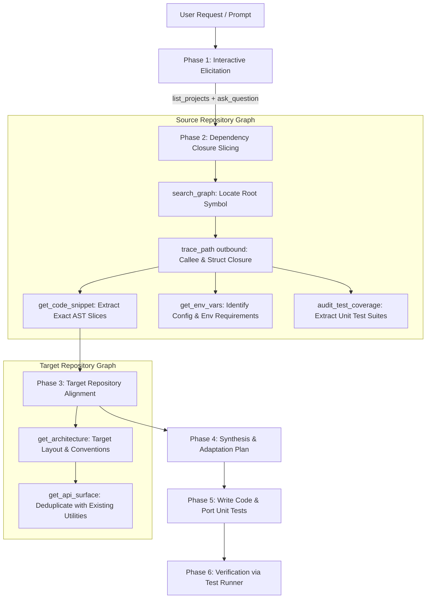

# Cross-Repository Feature Transplant Skill

Use this skill when the user asks to:
- Copy, transplant, or port functionality, a module, or an algorithm from one repository into another.
- Extract a complete transitive dependency closure (helper functions, types, constants) for a symbol.
- Port corresponding unit tests to guarantee functional parity in the destination repository.
- Explore multiple repositories simultaneously or compare architectures across projects.

---

## 1. Quick Workflow Overview



---

## 2. Phase-by-Phase Execution Runbook

### Phase 1: Interactive Elicitation & Project Discovery
1. **Discover Indexed Projects**: Call `list_projects` to obtain the catalog of indexed repositories.
2. **Interactive Selection via `ask_question`**:
   - If `source_project` is unspecified or placeholder (`<source_project>`), prompt the user with available options:
     - Option list: `projects.map(p => p.name)`
     - Question: *"Which source repository contains the feature you want to copy?"*
   - If `target_project` is unspecified or placeholder (`<target_project>`), prompt the user:
     - Question: *"Which target repository should receive the transplanted feature?"*
   - If `feature` is unspecified or placeholder (`<feature>`), ask the user:
     - Question: *"What function, class, module, or algorithm would you like to transplant? (e.g. DiagramRecommender, token_counter, or auth_middleware)"*

### Phase 2: Dependency Closure Slicing (Source Repository)
Do not just copy a single file. Compute the full dependency closure:
1. **Find Root Symbol**:
   ```json
   search_graph(project=SOURCE, name_pattern=FEATURE_NAME)
   ```
2. **Trace Callee Tree (Transitive Outbound Closure)**:
   ```json
   trace_path(project=SOURCE, function_name=ROOT_SYMBOL, direction="outbound", depth=3)
   ```
   Identify all internal helper functions, data types, structs, and interfaces required by the root symbol.
3. **Extract Exact AST Code Snippets**:
   For the root symbol and each dependent callee identified:
   ```json
   get_code_snippet(project=SOURCE, qualified_name=CALLEE_PATH)
   ```
4. **Inspect Environment & Config Requirements**:
   ```json
   get_env_vars(project=SOURCE)
   ```
   Check if the transplanted logic references environment variables or external configuration flags.
5. **Extract Covering Unit Tests**:
   ```json
   trace_path(project=SOURCE, function_name=ROOT_SYMBOL, direction="inbound", include_tests=true)
   audit_test_coverage(project=SOURCE, scope_path=FEATURE_PATH)
   ```
   Identify the test files and specific test cases verifying this feature in the source project.

### Phase 3: Target Repository Alignment
1. **Inspect Target Conventions**:
   ```json
   get_architecture(project=TARGET)
   ```
   Identify target repository conventions:
   - Language & runtime (TypeScript ESM vs C11 vs Python).
   - Directory structures (e.g. `src/utils/`, `pkg/`, `lib/`).
   - Error handling patterns (Result types, exceptions, errno).
2. **Deduplication Check**:
   ```json
   get_api_surface(project=TARGET)
   ```
   Verify whether equivalent helper functions (e.g., hash functions, JSON parsers, string formatters) already exist in the target to avoid redundant code clones.

### Phase 4: Synthesis & Adaptation Plan
Create an artifact or structured plan outlining:
- Source symbols extracted.
- Target destination file paths.
- Necessary syntax or import adaptations (e.g., adapting imports from source project layout to target project structure).
- Unit tests to port alongside the feature.

### Phase 5: Code Generation & Test Porting
1. Write the adapted implementation files to the destination repository.
2. Port the corresponding unit test suite to the target repository’s test directory (e.g. `tests/`, `src/__tests__/`).

### Phase 6: Verification
Execute the target repository's native test runner to confirm that the transplanted feature compiles and passes all unit tests:
- JavaScript/TypeScript: `npm test`
- Native C: `make test` or `powershell update_mcp_exe.ps1`
- Python: `pytest`
- Go: `go test ./...`
