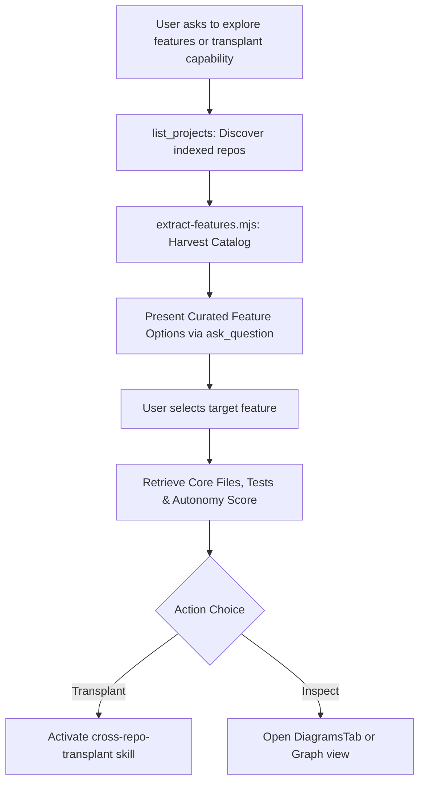

# Repository Capability & Feature Catalog (`feature-catalog`)

Use this skill when the user or agent asks to:
- Understand what capabilities and features a repository exposes without digging through low-level AST symbols.
- Extract a structured **Capability Catalog** for any indexed repository.
- Inspect **Autonomy Scores (0–100)** to determine how easily a feature can be ported or transplanted (RFC 019).
- Map surface entry points (HTTP routes, CLI commands, MCP tools, UI tabs) to internal implementation boundaries and test suites.
- Perform feature-level change impact reviews or blast radius assessments (RFC 001).

---

## 1. Quick Start

### Extract Feature Catalog for the Active Repository
```bash
# Output formatted Markdown catalog
node scripts/extract-features.mjs --project codebase-memory-mcp-ui

# Output machine-readable JSON catalog
node scripts/extract-features.mjs --project codebase-memory-mcp-ui --json
```

### Discover Capabilities in External Indexed Repositories
```bash
# List all indexed projects in Codebase Memory
node scripts/extract-features.mjs --list-projects

# Extract catalog for a specific repo
node scripts/extract-features.mjs --project docling
```

### Save Catalog to File
```bash
node scripts/extract-features.mjs --project codebase-memory-mcp-ui --out docs/FEATURE_CATALOG.md
```

---

## 2. Interactive Feature Elicitation Workflow

When working with users or running cross-repository operations (e.g. `transplant_feature` in RFC 019):



1. **Step 1: Check Discovered Features**: Run `node scripts/extract-features.mjs --project <project> --json`.
2. **Step 2: Present Options**: Prompt the user with high-level feature names and autonomy scores rather than low-level function names:
   ```json
   {
     "question": "Which capability would you like to investigate or transplant?",
     "options": [
       "Diagram Recommendation Engine & Studio (88/100 autonomy, 14 tests)",
       "Multi-Project Selection & Application-Wide Filter (88/100 autonomy, 2 tests)",
       "Cross-Repository Feature Transplant Engine (93/100 autonomy, 2 tests)",
       "AI Readiness Audit & Agent Context Hub (92/100 autonomy, 1 test)"
     ]
   }
   ```
3. **Step 3: Proceed with Full Context**: Use the feature's `coreFiles`, `surfaceTriggers`, and `testSuites` directly in subsequent analysis or transplantation steps.

---

## 3. Autonomy & Transplant Readiness Index

Each feature is evaluated on an **Autonomy Score (0–100)**:

| Score Range | Coupling Level | Verdict | Recommended Workflow |
|---|---|---|---|
| **80 – 100** | `low` | **Ready for Transplant** | Slices cleanly with minimal adapter code. Unit tests are intact. |
| **65 – 79** | `medium` | **Moderate Coupling** | Requires mapping shared internal utilities or stubbing singleton configurations. |
| **0 – 64** | `high` | **Tightly Coupled** | Entangled with core infrastructure; extract shared dependencies first. |

---

## 4. Cross-Tool Integration Reference

- **Feature Transplanting ([RFC 019](file:///docs/RFC_019_Interactive_Multi_Project_Elicitation_And_Cross_Repo_Transplant.md)):** Run `extract-features.mjs` first to find candidate roots for `scripts/transplant-feature.mjs`.
- **Diagram Recommendations ([RFC 016](file:///docs/RFC_016_Diagram_Recommendation_Engine.md)):** Use feature boundaries to scope per-feature architecture diagrams in `recommend-diagrams.mjs`.
- **Application-Wide Multi-Project Filtering ([RFC 020](file:///docs/RFC_020_Multi_Project_Selection_And_Application_Wide_Filter.md)):** Compare capabilities side-by-side across `selectedProjects`.
