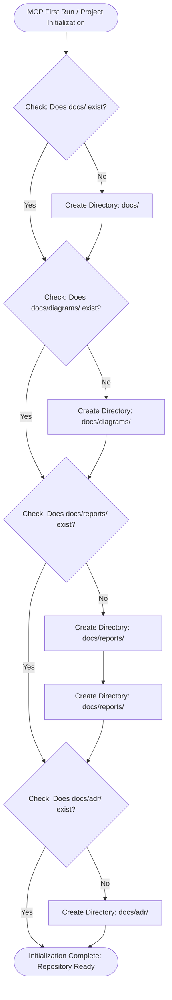
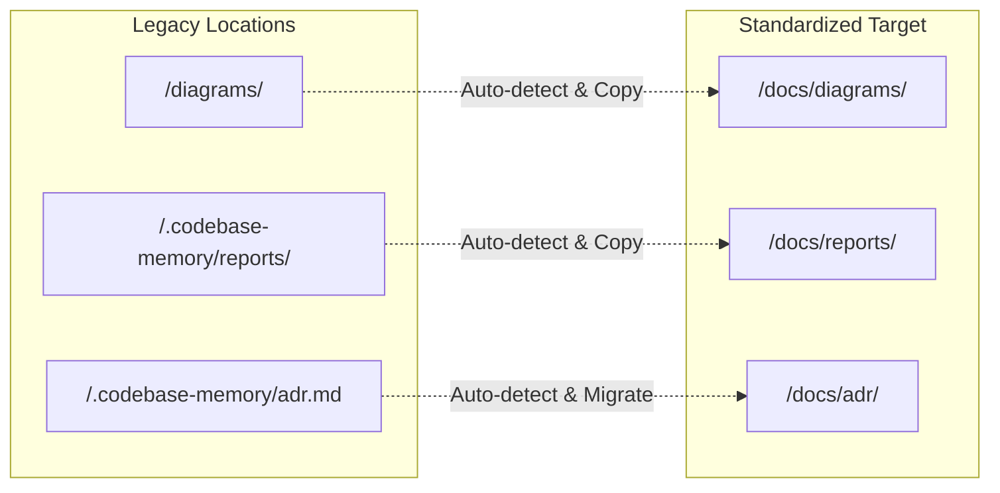

# RFC 017: Standardized Documentation & Artifact Directory Layout (`docs/`, `docs/diagrams/`, `docs/reports/`, `docs/adr/`)

- **RFC Number:** 017
- **Title:** Standardized Documentation & Artifact Directory Layout (`docs/`, `docs/diagrams/`, `docs/reports/`, `docs/adr/`)
- **Status:** Proposed
- **Author:** Codebase Memory Architecture Team
- **Target Subsystem:** `scripts/`, `src/mcp/`, `graph-ui/src/components/`, `docs/`, `.agents/skills/`
- **Target Version:** v0.17.0
- **Created:** 2026-10-13
- **Related RFCs:** [RFC 013](RFC_013_Update_Agent_Skills_With_New_Tools.md) (agent skills), [RFC 014](RFC_014_AI_Readiness_Audit_Tool.md) (AI readiness), [RFC 015](RFC_015_Repository_Analysis_Reports_Page.md) (reports page), [RFC 016](RFC_016_Diagram_Recommendation_Engine.md) (diagram recommendations & catalog)

---

## TL;DR — Impact at a Glance

| Question | Answer |
|---|---|
| **What does this RFC propose?** | A standardized repository directory structure where **all project-related documentation and generated artifacts are centralized under the `docs/` folder** (`docs/diagrams/`, `docs/reports/`, and `docs/adr/`). |
| **What does the MCP server do on first run?** | When Codebase Memory MCP initializes or runs against a repository for the first time, it performs an automated hierarchical verification and bootstrap sequence:<br>1. Checks for `<repo_root>/docs/`; if missing, creates it.<br>2. Checks for `<repo_root>/docs/diagrams/`; if missing, creates it.<br>3. Checks for `<repo_root>/docs/reports/`; if missing, creates it.<br>4. Checks for `<repo_root>/docs/adr/`; if missing, creates it. |
| **Why is this needed?** | Historically, generated artifacts have been fragmented across multiple locations: top-level `diagrams/` in the repo root, reports saved to `.codebase-memory/reports/` or loose root markdown files (`BENCHMARK_REPORT.md`, `TEST_PLAN.md`), and ADRs stored exclusively in SQLite or `.codebase-memory/adr.md`. This scatters knowledge, clutters repository roots, and confuses AI agents and human contributors looking for architecture documentation. |
| **How does it handle existing files?** | A non-destructive, bidirectional migration strategy: existing diagrams in `<repo_root>/diagrams/` and reports in `<repo_root>/.codebase-memory/reports/` are auto-detected and can be seamlessly read or migrated to `docs/diagrams/` and `docs/reports/` without data loss. |
| **Does it touch Core C?** | **No.** In strict compliance with the **Core C Preference Rule**, directory scaffolding, artifact orchestration, CLI runners, and UI bindings are implemented in TypeScript/Node.js scripts, MCP tool orchestration layers, and React UI components. |

---

## 1. Motivation & Problem Statement

### 1.1 The Root-Level Clutter & Fragmentation Problem
As Codebase Memory has expanded through RFC 001–016, it has introduced rich analytical outputs:
1. **Interactive Architectural Diagrams (RFC 016):** Catalogs, Mermaid AST files, Archify JSON specs, and standalone vector HTML pages originally designated to `<repo_root>/diagrams/`.
2. **Repository Health & Diagnostics Reports (RFC 015):** Snapshots, Fix-First risk queues, and Markdown summaries saved to `<repo_root>/.codebase-memory/reports/` or loose root files.
3. **Architecture Decision Records (RFC 013 & `manage_adr`):** Stored primarily inside internal SQLite WAL stores (`project_summaries` table) or legacy `<repo_root>/.codebase-memory/adr.md`.
4. **Ad-hoc Scratch Artifacts:** Root-level preview images (`diagrams_*.png`), temporary benchmark dumps, and audit logs.

This ad-hoc distribution creates several critical issues:
- **Repository Pollution:** Adding new top-level directories (`/diagrams`, `/reports`, `/adr`) at the root level violates established open-source conventions and clutters root workspace navigation in IDEs and Git hosting platforms (GitHub, GitLab).
- **AI Agent Discovery Blindspots:** AI coding agents (Claude Code, Cursor, Codex, Copilot) look in `docs/` by default for project knowledge. When architecture diagrams or audit reports are hidden in dot-directories like `.codebase-memory/` or scattered across arbitrary root directories, agents fail to locate authoritative project context.
- **Inconsistent Backup & Version Control:** Teams want to commit architectural diagrams, reports, and ADRs to Git so they evolve with the codebase, but `.codebase-memory/` is typically git-ignored, causing generated reports and ADR insights to be lost on fresh clones.

### 1.2 The Standardized Solution
Adopt the universal convention that **all human-readable and agent-facing project artifacts belong in `docs/`**, organized cleanly into dedicated subdirectories:

```
<repo_root>/
├── docs/
│   ├── diagrams/           <-- Architectural maps, Mermaid AST, specs, HTML visualizers
│   │   ├── catalog.json
│   │   ├── architecture.html
│   │   ├── architecture.mermaid
│   │   └── specs/
│   │       └── architecture.json
│   ├── reports/            <-- Health reports, Fix-First queues, JSON snapshots, Markdown audits
│   │   ├── latest.json
│   │   ├── <project>-<timestamp>.json
│   │   └── <project>-<timestamp>.md
│   ├── adr/                <-- Architecture Decision Records in markdown format
│   │   ├── 0001-init.md
│   │   └── index.md
│   ├── RFC_*.md            <-- Architecture RFCs and design specifications
│   └── ...                 <-- General guides and documentation
```

---

## 2. Automated MCP Initialization & Bootstrap Protocol

When Codebase Memory MCP is first run against a repository (e.g., during project registration, first index run via `index_repository`, or on first tool call), the MCP server or runner executes an **Automated Directory Bootstrap Check**.

### 2.1 The Initialization Flowchart



### 2.2 Bootstrap Sequence Specification

1. **Step 1: Check `docs/` Root**
   - Path: `<repo_root>/docs`
   - Action: If not found, execute `mkdir -p docs`.
   - Logging: Log notice `[cbm-init] Initialized docs/ directory at <repo_root>/docs`.

2. **Step 2: Check `docs/diagrams/` Directory**
   - Path: `<repo_root>/docs/diagrams`
   - Action: If not found, execute `mkdir -p docs/diagrams` and `mkdir -p docs/diagrams/specs`.
   - Seed Content: If no diagrams exist, initialize an empty `catalog.json` with schema header:
     ```json
     {
       "version": "1.0.0",
       "project": "<project_name>",
       "updated_at": "<iso_timestamp>",
       "diagrams": []
     }
     ```

3. **Step 3: Check `docs/reports/` Directory**
   - Path: `<repo_root>/docs/reports`
   - Action: If not found, execute `mkdir -p docs/reports`.
   - Purpose: Destination for `run-repo-report.mjs`, CI health gate outputs, and historical quality snapshot trends.

4. **Step 4: Check `docs/adr/` Directory**
   - Path: `<repo_root>/docs/adr`
   - Action: If not found, execute `mkdir -p docs/adr`.
   - Purpose: Destination for markdown-formatted ADR documents, enabling Git tracking alongside code.

---

## 3. Subsystem Updates & Target Alignments

### 3.1 Diagram Recommendation Engine & Catalog (RFC 016)
- **Previous Location:** `<repo_root>/diagrams/`
- **Updated Location:** `<repo_root>/docs/diagrams/`
- **Updated Scripts:**
  - `scripts/recommend-diagrams.mjs`: Updates `ensureRepoDiagramsDir()` to point to `path.join(repoPath, "docs", "diagrams")`.
  - `scripts/recommend_engine.mjs`:
    - `writeRepoDiagramSuite()` writes to `docs/diagrams/`.
    - `loadRepoDiagramsCatalog()` reads from `docs/diagrams/catalog.json` with fallback to legacy `diagrams/catalog.json`.

### 3.2 Repository Health Reports (RFC 015)
- **Previous Location:** `<repo_root>/.codebase-memory/reports/`
- **Updated Location:** `<repo_root>/docs/reports/`
- **Updated Scripts:**
  - `scripts/report_runner.mjs`: `saveReportToFile()` updates target directory from `.codebase-memory/reports` to `docs/reports`.
  - `scripts/run-repo-report.mjs`: CLI flag `--save` writes snapshot JSON and Markdown files directly into `docs/reports/`.
  - Export utilities: Exports from `graph-ui/src/components/reports/ExportModal.tsx` recommend `docs/reports/` as the default destination.

### 3.3 Architecture Decision Records (`manage_adr` & UI)
- **Previous Location:** Internal SQLite database (`project_summaries` table) with fallback to `<repo_root>/.codebase-memory/adr.md`.
- **Updated Location:** `<repo_root>/docs/adr/`
- **Export & Sync Mechanism:**
  - When ADRs are created or modified via `manage_adr(mode="update")` or the Web UI `AdrTab`, a markdown copy is automatically synced to `docs/adr/ADR-001.md` (or `docs/adr/index.md`).
  - Allows human reviewers and Git history to track architectural evolution directly in pull requests.

### 3.4 Web UI Static Serving (`graph-ui`)
- The CBM Web Server serves static files from both `graph-ui/public/` and mounts `<repo_root>/docs/` so that diagrams, specs, and report assets can be accessed at:
  - `http://localhost:9749/docs/diagrams/...`
  - `http://localhost:9749/docs/reports/...`
  - `http://localhost:9749/docs/adr/...`

---

## 4. Migration Strategy & Backward Compatibility

To prevent breaking existing workflows and installations, RFC 017 defines a seamless, non-destructive migration process:



1. **Read Precedence (Fallback Lookup):**
   - Diagrams: Check `docs/diagrams/catalog.json`. If not found, fall back to `diagrams/catalog.json`.
   - Reports: Check `docs/reports/latest.json`. If not found, fall back to `.codebase-memory/reports/latest.json`.
   - ADR: Check `docs/adr/`. If not found, fall back to `.codebase-memory/adr.md` and SQLite store.
2. **Write Precedence (Forward Migration):**
   - All *new* saves, exports, and automated post-indexing hooks write exclusively to `docs/diagrams/`, `docs/reports/`, and `docs/adr/`.
   - When an existing legacy directory is detected during first run, the MCP offers or automatically performs a clean non-destructive copy into the new `docs/` structure.

---

## 5. Implementation Architecture & Core C Preference

In strict adherence to the **Core C Preference Rule**:
- **Zero Modifications to Core C Engine:** Core C remains dedicated to high-speed AST parsing, tree-sitter grammars, and SQLite graph indexing.
- **Implementation via Node.js/TypeScript:**
  - A lightweight bootstrap helper (`scripts/ensure-docs-layout.mjs`) handles the `docs/` -> `docs/diagrams/` -> `docs/reports/` -> `docs/adr/` verification and directory creation.
  - Can be invoked from the CLI, post-index lifecycle hooks, or pre-tool execution middleware in the Node.js/TypeScript runner layer.

---

## 6. Git Hygiene & `.gitignore` Updates

With the centralization of project documentation under `docs/`:

1. **Committed to Git (Tracked):**
   - `docs/diagrams/*.mermaid`: Small, version-controllable text definitions of architecture diagrams.
   - `docs/diagrams/catalog.json`: Registered index of repository diagrams.
   - `docs/diagrams/specs/*.json`: Archify visual specifications.
   - `docs/adr/*.md`: Architecture decision records.
   - `docs/RFC_*.md`: Architectural specifications.
2. **Optional / User Discretion in `.gitignore`:**
   - Large standalone HTML bundles (`docs/diagrams/*.html`) or transient binary screenshots (`docs/diagrams/*.png`) can be optionally ignored or checked in based on team preference.
   - Intermediate report snapshots (`docs/reports/*.json`) can be checked in for audit logs or ignored if generated ephemerally in CI.

---

## 7. Verification & Acceptance Criteria

- [ ] **Bootstrap Check on Clean Repo:** Running the MCP against a repository with no `docs/` folder creates `docs/`, `docs/diagrams/`, `docs/reports/`, and `docs/adr/` in a single pass.
- [ ] **Idempotence:** Running the bootstrap check multiple times on an already-configured repository succeeds with zero side effects or file overwrites.
- [ ] **Diagram Persistence:** Post-index system overview and diagram recommendations write to `docs/diagrams/`.
- [ ] **Report Persistence:** `node scripts/run-repo-report.mjs --save` persists `latest.json` and timestamped snapshots to `docs/reports/`.
- [ ] **ADR Persistence:** Creating or updating an ADR through MCP or UI syncs a markdown representation to `docs/adr/`.
- [ ] **Backward Compatibility:** Repositories with existing `diagrams/` or `.codebase-memory/reports/` continue to load without errors.
