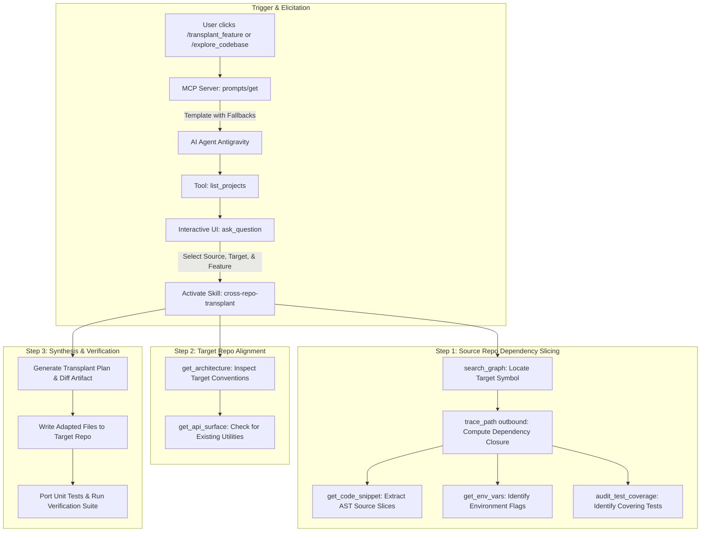

# RFC 019: Interactive Agent Elicitation, Multi-Project Scope & Cross-Repo Feature Transplanting

- **RFC Number:** 019
- **Title:** Interactive Agent Elicitation, Multi-Project Scope & Cross-Repo Feature Transplanting
- **Status:** Proposed
- **Author:** Codebase Memory Architecture Team
- **Target Subsystem:** `src/mcp/mcp.c`, `tests/test_mcp.c`, `.agents/skills/cross-repo-transplant/`, `scripts/`
- **Target Version:** v0.19.0
- **Created:** 2026-10-14
- **Related RFCs:** [RFC 001](RFC_001_analyze_blast_radius.md) (Blast Radius), [RFC 002](RFC_002_get_api_surface.md) (API Surface), [RFC 003](RFC_003_audit_test_coverage.md) (Audit Test Coverage), [RFC 006](RFC_006_get_env_vars.md) (Environment Variables), [RFC 013](RFC_013_Update_Agent_Skills_With_New_Tools.md) (Agent Skills), [RFC 014](RFC_014_AI_Readiness_Audit_Tool.md) (AI Readiness), [RFC 018](RFC_018_Agent_Context_And_Instruction_Architecture.md) (Agent Context Architecture)

---

## TL;DR — Impact at a Glance

| Question | Answer |
|---|---|
| **What does this RFC propose?** | 1. **Robust MCP Prompt Handlers:** Resolves the `-32602 Missing required prompt arguments` failure in MCP clients (Antigravity IDE, Claude Code, Cursor) by relaxing required arguments and injecting fallback placeholders with agent elicitation directives.<br>2. **Interactive Agent Elicitation:** Instructs AI agents to converse interactively with the user (via `ask_question`) until all missing parameters are resolved before running deep graph traversals.<br>3. **Multi-Project Scope Support:** Integrates `list_projects` into prompt workflows, enabling users to select and investigate across multiple indexed repositories.<br>4. **Cross-Repo Feature Transplanting Engine:** Introduces a dedicated prompt (`transplant_feature`) and Agent Skill (`cross-repo-transplant`) that extracts a complete dependency slice from a source repository (AST code, outbound call trees, environment variables, and unit tests) and ports it cleanly into a target repository. |
| **Why is this needed?** | Today, clicking `explore_codebase` or `review_change_impact` in the IDE prompt menu crashes with a missing arguments error because clients fetch templates without pre-filled parameters. Furthermore, codebases are investigated in isolation—engineers and agents cannot easily transplant a proven algorithm, utility module, or API integration from one indexed repo into another without manual copy-paste, missing transitive dependencies, and unported tests. |
| **Does it touch Core C?** | **Minimally and strictly justified.** Under the **Core C Preference Rule**, Core C is touched **only** for the strict technical constraint: `src/mcp/mcp.c` serves MCP protocol requests directly, requiring ~20 lines changed to relax `required: false` and supply default templates. **All** multi-turn conversational elicitation, AST synthesis, adaptation, and porting logic live entirely outside C in an Agent Skill (`.agents/skills/cross-repo-transplant/`) and Node.js scripts. |
| **How does Feature Transplanting work?** | 1. **Elicit:** Agent prompts user for `source_project`, `target_project`, and target symbol/feature.<br>2. **Slice:** Queries `search_graph`, `trace_path(outbound)`, `get_env_vars`, and `audit_test_coverage` in the source repo.<br>3. **Align:** Evaluates target repo architecture and conventions via `get_architecture`.<br>4. **Synthesize:** Produces adapted code, installs required dependencies, and ports source unit tests. |

---

## 1. Motivation & Problem Statement

### 1.1 The MCP Prompt Zero-Argument Trap
In the Model Context Protocol (MCP) specification, servers can publish reusable prompt templates via `prompts/list`. Clients (such as Antigravity IDE, Claude Desktop, and Cursor) render these prompts as quick-action buttons or slash commands.

However, when a user selects a prompt like `explore_codebase` in Antigravity IDE:
```
Error fetching MCP prompt
Failed to get prompt: failed to get prompt explore_codebase from codebase-memory-mcp: %!v(MISSING): calling "prompts/get": Missing required prompt arguments (error ID: 2d7f3caca4b14ee1a2c2b185f6cca931)
```

**Root Cause:**
In `src/mcp/mcp.c`, prompt arguments are marked `required: true`:
```c
mcp_add_prompt_argument(doc, explore_arguments, "project", "Project",
                        "Indexed project name from list_projects.", true);
mcp_add_prompt_argument(doc, explore_arguments, "question", "Question",
                        "Architecture or implementation question to investigate.", true);
```
When `prompts/get` is called without pre-populated arguments, `cbm_mcp_prompt_get` rejects the call with JSON-RPC error code `-32602`:
```c
if (!project || !request) {
    *error_json = mcp_prompt_error_json(JSONRPC_INVALID_PARAMS, "Missing required prompt arguments");
    return NULL;
}
```
Because the client UI does not render an upfront parameter input form before fetching the prompt template, the operation fails catastrophically for the user.

### 1.2 Lack of Interactive Multi-Turn Elicitation
Static prompt templates fail when user intent is underspecified. Rather than throwing a protocol error, modern agentic systems should implement **cooperative elicitation**:
1. The server returns the prompt template with explicit agent directives.
2. The agent detects missing parameters (`<project>`, `<question>`).
3. The agent proactively queries available resources (e.g. `list_projects`) and prompts the user using interactive modal dialogues (`ask_question`) until all necessary parameters are gathered.

### 1.3 The Cross-Repository Porting Barrier
Modern engineering teams maintain multiple repositories: a frontend UI, a backend daemon, shared libraries, and specialized microservices. A common workflow is **feature transplanting**: copying a working capability from one repository to another (e.g., porting a ranking algorithm from a backend service into an MCP UI server).

Today, doing this manually or through raw LLM chat is error-prone:
- **Hidden Dependencies:** Helper functions, constants, and nested AST types are omitted.
- **Missing Configs:** Undocumented environment variables or build flags are lost.
- **Untested Transplants:** Tests that verified the feature in Repo A are left behind, leading to regressions in Repo B.

By combining Codebase Memory’s multi-project knowledge graphs with agentic orchestration, we can make feature transplantation **deterministic, verified, and complete**.

---

## 2. Core C Preference Rule Justification

The user-defined project rule stipulates:
> **Core C Preference Rule:** ALWAYS prefer implementations that do NOT touch or modify the Core C codebase... ONLY propose or implement changes in Core C when there is a serious, demonstrable performance difference or a strict technical constraint that cannot be achieved outside C.

### Strict Technical Constraint Analysis
1. **Protocol Ownership:** The compiled binary `codebase-memory-mcp.exe` acts as the direct MCP server. The IDE connects to it over stdio or HTTP without an intermediate proxy.
2. **Crash Prevention Requires C:** The `-32602 Missing required prompt arguments` error is returned directly by `cbm_mcp_prompt_get` in `src/mcp/mcp.c`. No external script or agent skill can intercept or bypass this error if the native binary rejects the initial handshake.
3. **Boundary of Responsibilities:**
   - **Core C Role (Minimal):** Set `required: false` in `cbm_mcp_prompts_list`, populate fallback placeholders (`<project>`, `<question>`) in `cbm_mcp_prompt_get`, and register a new `transplant_feature` prompt template (~20 lines of C).
   - **Outside C Role (Maximum):** Multi-project enumeration, interactive user UI dialogues (`ask_question`), dependency closure calculation, AST code synthesis, target adaptation, and test porting are handled **100% in Agent Skills and Node.js scripts**.

---

## 3. Design Goals & Non-Goals

### 3.1 Goals
- **G-1: Zero-Crash Handshake:** `prompts/get` calls with missing or empty arguments must succeed with HTTP/JSON-RPC 200, returning template directives instead of `-32602`.
- **G-2: Cooperative Agent Elicitation:** Prompts must embed unambiguous instructions for AI agents to query the user interactively (e.g., via `ask_question`) when placeholders are present.
- **G-3: Multi-Project Discovery:** Integrates `list_projects` into prompt workflows to allow users to select from available indexed repositories.
- **G-4: End-to-End Feature Transplanting:** A formal workflow to port a feature from Project A to Project B, extracting the complete transitive dependency closure:
  - Root symbols & outbound call hierarchies (`search_graph`, `trace_path`).
  - Required environment variables (`get_env_vars`).
  - Associated unit tests (`audit_test_coverage`).
  - Target architecture alignment (`get_architecture`).
- **G-5: Verification & Parity Testing:** Automatically port unit tests into the target repository and execute them to verify that the transplanted feature works as intended.

### 3.2 Non-Goals
- **NG-1: In-C Code Synthesis:** Core C will not parse ASTs across repositories or generate code.
- **NG-2: Automatic Git Commits:** The transplant engine will stage and propose changes, but will not perform automated commits or pushes without user consent.

---

## 4. Architecture & Workflow

### 4.1 Cross-Repo Feature Transplanting Flow



---

## 5. Specification

### 5.1 Core C Protocol Schema (`src/mcp/mcp.c`)

#### Prompt Schema Updates (`cbm_mcp_prompts_list`)
All prompt arguments are relaxed to `required: false` to allow IDE prompt pickers to fetch them unconditionally:

```c
static char *cbm_mcp_prompts_list(void) {
    ...
    // 1. explore_codebase
    mcp_add_prompt_argument(doc, explore_arguments, "project", "Project",
                            "Indexed project name from list_projects.", false);
    mcp_add_prompt_argument(doc, explore_arguments, "question", "Question",
                            "Architecture or implementation question to investigate.", false);

    // 2. review_change_impact
    mcp_add_prompt_argument(doc, review_arguments, "project", "Project",
                            "Indexed project name from list_projects.", false);
    mcp_add_prompt_argument(doc, review_arguments, "change", "Change",
                            "Change, symbol, or area whose impact should be reviewed.", false);
    mcp_add_prompt_argument(doc, review_arguments, "base_branch", "Base branch",
                            "Git branch or ref for detect_changes; defaults to main.", false);

    // 3. transplant_feature (NEW)
    yyjson_mut_val *transplant = yyjson_mut_obj(doc);
    yyjson_mut_obj_add_str(doc, transplant, "name", "transplant_feature");
    yyjson_mut_obj_add_str(doc, transplant, "title", "Transplant feature between repositories");
    yyjson_mut_obj_add_str(doc, transplant, "description",
                           "Port a function, module, or capability from one indexed repo into another.");
    yyjson_mut_val *transplant_args = yyjson_mut_arr(doc);
    mcp_add_prompt_argument(doc, transplant_args, "source_project", "Source Project",
                            "Origin project name from list_projects.", false);
    mcp_add_prompt_argument(doc, transplant_args, "target_project", "Target Project",
                            "Destination project name from list_projects.", false);
    mcp_add_prompt_argument(doc, transplant_args, "feature", "Feature or Symbol",
                            "Name of function, class, or capability to port.", false);
    yyjson_mut_obj_add_val(doc, transplant, "arguments", transplant_args);
    yyjson_mut_arr_add_val(prompts, transplant);
    ...
}
```

#### Template Handlers with Elicitation Directives (`cbm_mcp_prompt_get`)
When an argument is NULL or empty, fallback placeholders are substituted and agent directives are appended:

```c
static const char EXPLORE_TEMPLATE[] =
    "Explore project \"%s\" to answer: %s\n\n"
    "Agent Directives:\n"
    "1. If the project or question is unspecified or placeholder (<project>, <question>), "
    "call list_projects and ask the user clarifying questions using ask_question before proceeding.\n"
    "2. If multiple projects are relevant, ask the user whether to analyze a single project or cross-compare.\n"
    "3. Use graph tools first: search_graph for symbols, get_code_snippet for exact source, and "
    "trace_path(direction=\"both\") for callers/callees. Use get_architecture for broad orientation.";

static const char TRANSPLANT_TEMPLATE[] =
    "Transplant feature \"%s\" from source project \"%s\" into target project \"%s\".\n\n"
    "Agent Directives:\n"
    "1. If source_project, target_project, or feature is unspecified or placeholder, call list_projects "
    "and prompt the user to select source and target repositories and specify the feature.\n"
    "2. Activate skill `cross-repo-transplant`.\n"
    "3. Slicing: Locate the feature in the source project via search_graph, compute its full outbound "
    "call closure via trace_path, and retrieve source definitions with get_code_snippet.\n"
    "4. Configuration & Tests: Query get_env_vars for required configs and audit_test_coverage for tests.\n"
    "5. Target Alignment: Inspect target project via get_architecture, adapt code to target conventions, "
    "and port the unit tests to verify parity.";
```

---

### 5.2 Interactive Elicitation Protocol

When an agent encounters `<project>`, `<source_project>`, or `<question>`:
1. **Query Active Projects:** The agent invokes `list_projects()`.
2. **Multi-Choice Modal:** The agent triggers `ask_question`:
   - Single project exploration:
     ```json
     {
       "question": "Which indexed project would you like to explore?",
       "options": ["ronaldpschutte/codebase-memory-mcp-ui", "payments-service", "auth-gateway"],
       "is_multi_select": false
     }
     ```
   - Cross-repo transplanting:
     ```json
     {
       "question": "Select the SOURCE project containing the feature to copy:",
       "options": ["payments-service", "auth-gateway"],
       "is_multi_select": false
     }
     ```
     followed by:
     ```json
     {
       "question": "Select the TARGET project to port the feature into:",
       "options": ["ronaldpschutte/codebase-memory-mcp-ui"],
       "is_multi_select": false
     }
     ```
3. **Feature Goal Clarification:** If the specific symbol or feature is broad, the agent asks:
   > *"What specific function, module, or capability do you want to transplant? (e.g. `generate_jwt_token`, `DiagramRecommender`, or `auth_middleware`)"*

---

### 5.3 Dedicated Agent Skill: `cross-repo-transplant`

A new agent skill is established in `.agents/skills/cross-repo-transplant/SKILL.md`:

```markdown
---
name: cross-repo-transplant
description: "Transplant functions, modules, and capabilities between indexed repositories with dependency closure extraction, AST adaptation, and test porting."
---

# Cross-Repository Feature Transplant Runbook

## Phase 1: Dependency Closure Slicing (Source Repository)
1. **Locate Root Symbol:** Call `search_graph(project=SOURCE, name_pattern=FEATURE_NAME)`.
2. **Trace Callee Closure:** Call `trace_path(project=SOURCE, function_name=ROOT_SYMBOL, direction="outbound", depth=3)` to enumerate all internal helper functions, data types, and classes required by the feature.
3. **Retrieve Source Code:** For every symbol in the closure, call `get_code_snippet(project=SOURCE, qualified_name=...)`.
4. **Identify Configs:** Call `get_env_vars(project=SOURCE)` to determine required environment variables.
5. **Extract Unit Tests:** Call `trace_path(project=SOURCE, function_name=ROOT_SYMBOL, direction="inbound", include_tests=true)` and `audit_test_coverage` to locate all test suites asserting this feature.

## Phase 2: Target Repository Alignment
1. **Analyze Conventions:** Call `get_architecture(project=TARGET)` to identify directory layouts, module systems (ESM vs CommonJS, header files vs C modules), and style patterns.
2. **Check Existing Utilities:** Call `get_api_surface(project=TARGET)` to verify if any utility functions in the slice already exist in the target to avoid duplication.

## Phase 3: Synthesis & Adaptation Plan
1. Present an interactive markdown summary of the transplant plan:
   - Source symbols & files extracted.
   - Target destination file paths.
   - Code adaptations (import paths, typing, syntax).
   - Ported unit tests.
2. Solicit user confirmation before writing files.

## Phase 4: Code Generation & Verification
1. Write the adapted source files into the target repository.
2. Write the ported unit test files.
3. Run the target repository test runner (`npm test`, `pytest`, `cargo test`, or `make test`) to verify 100% test pass rate.
```

---

## 6. Verification & Test Plan

### 6.1 Native C Test Suite (`tests/test_mcp.c`)
- **`server_handle_prompts_list_optional_arguments`**: Verify that `prompts/list` advertises `required: false` for all prompt parameters.
- **`server_handle_prompts_get_zero_arguments`**: Verify that invoking `prompts/get` with `{"name": "explore_codebase"}` or `{"name": "transplant_feature"}` succeeds with code 200 and includes fallback placeholders (`<project>`, `<question>`) and agent directives.
- **`server_handle_prompts_get_supplied_arguments`**: Verify that concrete arguments are properly interpolated into the response messages.

### 6.2 Agent Elicitation Verification
- Invoke `explore_codebase` in Antigravity IDE without arguments.
- Verify that the agent receives the directives, invokes `list_projects`, and prompts the user via `ask_question`.

### 6.3 Feature Transplant End-to-End Verification
- Select a utility function from a secondary indexed project and port it into `codebase-memory-mcp-ui`.
- Verify that:
  1. The dependency slice includes all helper functions.
  2. The target files are written in proper TypeScript/React style.
  3. The ported unit tests run and pass cleanly.

---

## 7. Implementation Checklist

- [ ] **Phase 1: Core C Schema Relaxation (`src/mcp/mcp.c`)**
  - Update `cbm_mcp_prompts_list` (`required: false` on all arguments).
  - Register `transplant_feature` prompt template.
  - Update `cbm_mcp_prompt_get` with fallback placeholders and elicitation directives.
  - Update `tests/test_mcp.c` unit tests.
  - Rebuild `codebase-memory-mcp.exe` via WSL/MinGW (`update_mcp_exe.ps1`).
- [ ] **Phase 2: Agent Skill Definition**
  - Create `.agents/skills/cross-repo-transplant/SKILL.md`.
  - Add runbook instructions for dependency closure slicing, target alignment, and test porting.
- [ ] **Phase 3: Integration & Documentation**
  - Update `ARCHITECTURE.md` and `docs/llms.txt`.
  - Add CLI helper script `scripts/transplant-feature.mjs` for headless cross-repo porting.
