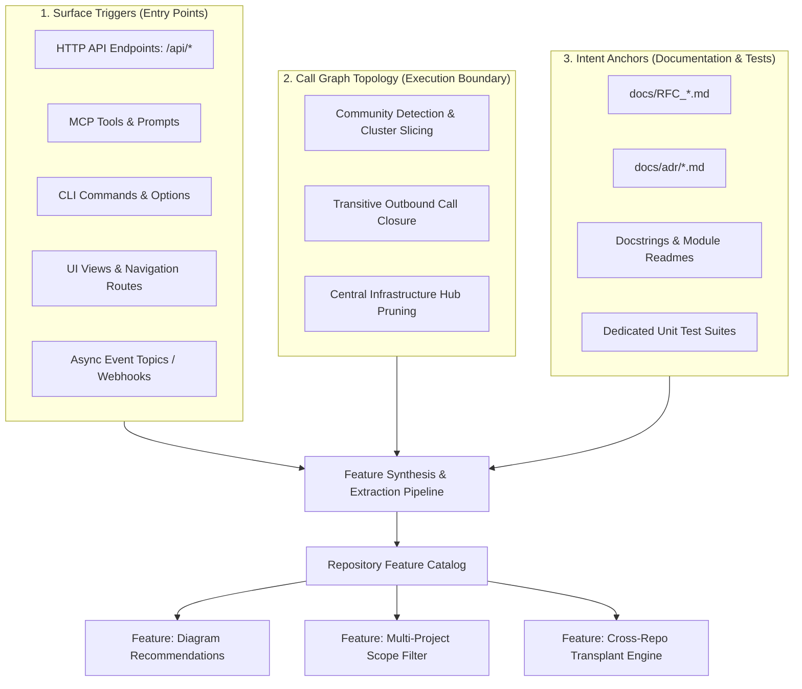
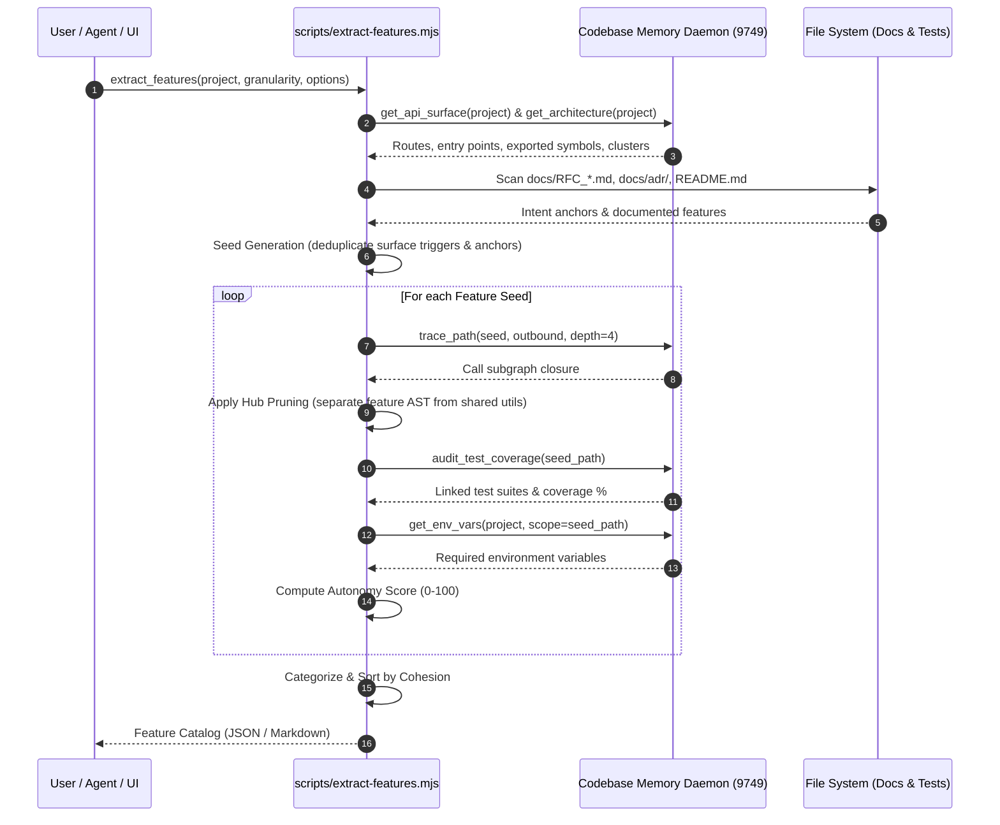

# RFC 021: Automated Repository Feature Extraction & Capability Catalog

- **RFC Number:** 021
- **Title:** Automated Repository Feature Extraction & Capability Catalog
- **Status:** Proposed
- **Author:** Codebase Memory Architecture Team
- **Target Subsystem:** `.agents/skills/feature-catalog/`, `scripts/extract-features.mjs`, `graph-ui/src/components/FeaturesTab.tsx`, `graph-ui/src/components/ToolsTab.tsx`
- **Target Version:** v0.21.0
- **Created:** 2026-10-15
- **Related RFCs:** [RFC 001](RFC_001_analyze_blast_radius.md) (Blast Radius), [RFC 002](RFC_002_get_api_surface.md) (API Surface), [RFC 003](RFC_003_audit_test_coverage.md) (Audit Test Coverage), [RFC 006](RFC_006_get_env_vars.md) (Environment Variables), [RFC 014](RFC_014_AI_Readiness_Audit_Tool.md) (AI Readiness), [RFC 016](RFC_016_Diagram_Recommendation_Engine.md) (Diagram Recommendations), [RFC 018](RFC_018_Agent_Context_And_Instruction_Architecture.md) (Agent Context Architecture), [RFC 019](RFC_019_Interactive_Multi_Project_Elicitation_And_Cross_Repo_Transplant.md) (Multi-Project Elicitation & Cross-Repo Transplant), [RFC 020](RFC_020_Multi_Project_Selection_And_Application_Wide_Filter.md) (Multi-Project Selection & Application-Wide Filter)

---

## TL;DR — Impact at a Glance

| Question | Answer |
|---|---|
| **What does this RFC propose?** | 1. **Automated Feature Extraction Engine:** A multi-signal analysis pipeline that synthesizes surface entry points (HTTP routes, CLI flags, MCP tools, UI tabs), call-graph topology, and intent anchors (RFCs, ADRs, test suites) into a structured, functional **Capability & Feature Catalog**.<br>2. **Transplant Readiness & Autonomy Scoring:** An analytical metric (0–100) assessing how self-contained each feature is, identifying external dependencies, shared internal utilities, and covering unit tests.<br>3. **Integration with Cross-Repo Transplant (RFC 019):** Eliminates blind guessing of symbol names by providing a curated, interactive menu of features ready for extraction and porting across repositories.<br>4. **Interactive Capabilities Tab in Web UI (`graph-ui`):** A dedicated, searchable interface showcasing discovered features, entry triggers, architectural boundaries, and 1-click actions ("Inspect Graph", "Transplant Feature", "Generate Diagram"). |
| **Why is this needed?** | Codebase graphs currently provide thousands of low-level symbols (functions, structs, files), but software engineers, architects, and AI agents think in **functional capabilities** (e.g. *"JWT Authentication"*, *"Diagram Recommender"*, *"Stripe Webhook Processor"*). Without high-level feature abstraction, developers face steep onboarding curves, feature transplanting requires guessing symbol roots, and change impact reviews cannot express risk in business terms. |
| **Does it touch Core C?** | **No (0% Core C modifications).** Under the **Core C Preference Rule**, the entire extraction, graph synthesis, autonomy scoring, and UI visualization live outside Core C. The pipeline composes existing native MCP tools (`get_api_surface`, `get_architecture`, `audit_test_coverage`, `get_env_vars`, `manage_adr`, `query_graph`) via a Node.js CLI runner (`scripts/extract-features.mjs`), an Agent Skill (`.agents/skills/feature-catalog/`), and React components. |
| **Is it backwards compatible?** | **Yes, 100% backwards compatible.** The feature catalog is an additive capability layered on top of indexed project databases. It requires no database schema migrations and introduces no breaking changes to existing MCP tools or API routes. |

---

## 1. Motivation & Problem Statement

### 1.1 The "Symbol Trap" in Code Intelligence
Codebase Memory builds high-fidelity knowledge graphs containing tens of thousands of AST nodes:
- `search_graph` finds individual functions and structs by regex.
- `trace_path` navigates step-by-step caller and callee links.
- `get_architecture` summarizes macro-level metrics (language ratios, SCC cycles, layers).

However, a critical layer of abstraction is absent: **the functional feature level**.
Software systems are not merely collections of syntax trees; they are organized into cohesive vertical capabilities:
- An authentication system (login, token refresh, password hashing, OAuth callbacks).
- A billing pipeline (checkout sessions, invoice generation, payment provider webhooks).
- An indexing engine (AST parser, grammar loader, cache writer).

When an AI agent or engineer asks:
> *"What does this repository actually do?"*  
> *"What capabilities does it expose?"*  
> *"Can I port the diagram recommendation feature into my project?"*

Existing tools force the user into a manual search cycle: grepping for keywords, inspecting file trees, and trying to reconstruct the feature boundary by hand.

### 1.2 The Missing Link for Cross-Repo Feature Transplanting (RFC 019)
[RFC 019](RFC_019_Interactive_Multi_Project_Elicitation_And_Cross_Repo_Transplant.md) introduced interactive feature transplanting between repositories. However, its phase 1 currently relies on manual user specification:
```
"What function, class, module, or algorithm would you like to transplant? (e.g. DiagramRecommender, token_counter, or auth_middleware)"
```
If the user does not know the exact symbol name in the source repository, the transplant cannot proceed without extensive manual code discovery. An automated **Capability Catalog** transforms this workflow into a single structured prompt:
> *"Repository `docling` has 4 transplantable features: [1] PDF Chunking Engine (92% autonomy), [2] Table OCR Extractor (84% autonomy), [3] Markdown Converter (95% autonomy). Which one would you like to transplant?"*

### 1.3 High-Level Business Impact & Blast Radius
When reviewing pull requests, understanding blast radius in terms of affected files (e.g., `modified src/foundation/platform.c`) fails to convey business risk. With feature extraction, blast radius can be reported functionally:
> *"Modifying `platform.c` impacts 4 core features: `Multi-Project Indexing`, `Cross-Repo Linkage`, `Persistent Storage`, and `Daemon IPC`."*

---

## 2. Core C Preference Rule Justification

The user-defined project rule stipulates:
> **Core C Preference Rule:** ALWAYS prefer implementations that do NOT touch or modify the Core C codebase... ONLY propose or implement changes in Core C when there is a serious, demonstrable performance difference or a strict technical constraint that cannot be achieved outside C.

### Architectural Compliance Analysis
1. **Tool Composition vs. Engine Mutation:**
   Feature extraction is an analytical synthesis process. All necessary graph primitives already exist in native C:
   - `get_api_surface` extracts all routes and exported interfaces.
   - `get_architecture` provides entry points, layers, and topological clusters.
   - `trace_path` computes transitive outbound closures.
   - `audit_test_coverage` maps symbols to test suites.
   - `get_env_vars` maps configuration dependencies.
   - `manage_adr` reads architectural records.
2. **Implementation Locus:**
   By implementing the feature extraction engine in TypeScript/Node.js (`scripts/extract-features.mjs`) and surfacing it via an Agent Skill and React UI tab, **zero Core C modifications are required**.
3. **Conclusion:** **100% compliant with the Core C Preference Rule.**

---

## 3. Architecture & Feature Decomposition Model

### 3.1 The Three-Signal Feature Formulation
In software engineering, a feature is defined by the convergence of **surface entry points**, a **connected call closure**, and **semantic intent documentation**:



### 3.2 Topological Slicing & Hub Pruning
A common challenge in call-graph analysis is the "utility explosion": generic helpers (such as `malloc`, `log_info`, `str_concat`, `db_query`) are called by almost every function, which would falsely merge all features into one giant blob.

RFC 021 solves this with **Hub Pruning**:
1. Compute the in-degree and betweenness centrality of all nodes in the call graph.
2. Nodes with in-degree exceeding a dynamic threshold ($\tau = \mu + 2\sigma$, e.g., called by $> 20\%$ of all symbols) are classified as **Shared Infrastructure Nodes**.
3. When computing the transitive call closure for a feature seed, traversal stops at Shared Infrastructure Nodes, recording them as *shared dependencies* rather than internal feature code.

---

## 4. Extraction Pipeline Algorithm



### 4.1 Step-by-Step Execution Phases

1. **Phase 1: Seed Harvesting:**
   - Collect HTTP routes (`/api/...`, RPC methods).
   - Collect registered CLI commands and MCP tools.
   - Collect top-level UI routes and tab views.
   - Parse RFC titles, ADR titles, and module README headers.
2. **Phase 2: Subgraph Boundary Slicing:**
   - Starting from each seed symbol, traverse the outbound call tree (`CALLS`, `IMPORTS`, `REFERENCES`).
   - Group strongly coupled private helpers into the feature's core boundary.
   - Terminate traversal at shared infrastructure hubs.
3. **Phase 3: Semantic Classification:**
   Categorize features into canonical domains:
   - `Core / Domain Logic`
   - `API & Integration`
   - `UI & Presentation`
   - `Data & Persistence`
   - `DevOps & Build Infrastructure`
   - `Security & Authorization`
4. **Phase 4: Autonomy & Transplant Readiness Scoring:**
   Compute the **Autonomy Index** ($A \in [0, 100]$):
   $$A = 100 - (w_e \cdot E + w_s \cdot S + w_c \cdot C) + w_t \cdot T$$
   Where:
   - $E$: Count of external non-standard third-party library dependencies (penalty).
   - $S$: Count of tightly coupled shared internal singletons (penalty).
   - $C$: Cyclomatic complexity / cycle entanglement of the boundary.
   - $T$: Verification coverage ($+20$ if dedicated passing unit tests exist).

---

## 5. Specification & Interfaces

### 5.1 CLI Runner (`scripts/extract-features.mjs`)

```bash
# Extract feature catalog for a project
node scripts/extract-features.mjs --project codebase-memory-mcp-ui

# Filter by scope and output as JSON
node scripts/extract-features.mjs --project docling --scope-path src/models --json

# Export catalog directly to Markdown documentation
node scripts/extract-features.mjs --project codebase-memory-mcp-ui --out docs/FEATURE_CATALOG.md
```

#### CLI Options:
| Flag | Description | Default |
|---|---|---|
| `--project <name>` | Indexed project name in Codebase Memory | Active repository |
| `--scope-path <path>` | Restrict extraction to subpath | Root (`""`) |
| `--granularity <level>` | `"coarse"` (domains) or `"fine"` (capabilities) | `"coarse"` |
| `--mcp-url <url>` | Daemon endpoint URL | `http://127.0.0.1:9749` |
| `--json` | Output machine-readable JSON | `false` |
| `--out <file>` | Write result to file (Markdown or JSON) | `stdout` |

### 5.2 Agent Skill (`.agents/skills/feature-catalog/SKILL.md`)

Provides direct LLM runbooks so AI coding assistants can:
1. List capabilities for any indexed project automatically.
2. Present interactive selection dialogues (`ask_question`) during feature transplanting.
3. Verify feature autonomy before attempting code extraction.

### 5.3 Output Schema

```json
{
  "project": "codebase-memory-mcp-ui",
  "total_features": 7,
  "extraction_timestamp": "2026-10-15T10:30:00Z",
  "features": [
    {
      "id": "diagram_recommendations",
      "name": "Diagram Recommendation Engine",
      "category": "Analysis & Visualization",
      "summary": "Ranks and generates topological diagrams using graph centrality metrics.",
      "documentation": ["docs/RFC_016_Diagram_Recommendation_Engine.md"],
      "surface_triggers": [
        { "kind": "mcp_tool", "name": "export_diagram" },
        { "kind": "ui_tab", "name": "DiagramsTab" },
        { "kind": "script", "path": "scripts/recommend-diagrams.mjs" }
      ],
      "boundary": {
        "primary_files": [
          "src/diagram/recommend.c",
          "graph-ui/src/components/DiagramsTab.tsx",
          "scripts/recommend-diagrams.mjs"
        ],
        "root_symbols": ["cbm_diagram_recommend", "DiagramsTab"],
        "loc_estimate": 1420
      },
      "dependencies": {
        "external_libraries": ["mermaid", "three"],
        "shared_internal": ["cbm_malloc", "cbm_log"]
      },
      "verification": {
        "has_tests": true,
        "test_suites": [
          "tests/test_diagram_standalone.c",
          "graph-ui/src/components/DiagramsTab.test.tsx"
        ],
        "test_count": 14
      },
      "transplant_readiness": {
        "autonomy_score": 88,
        "coupling": "low",
        "verdict": "Ready for transplant with minimal adapter code."
      }
    }
  ]
}
```

---

## 6. UI & UX Design (`graph-ui`)

### 6.1 Interactive Capabilities View in `graph-ui`
In `graph-ui`, a dedicated view (or integrated section in the Tools / Projects tabs) displays the catalog as interactive, card-based components:

```
┌────────────────────────────────────────────────────────────────────────────────────────┐
│  Codebase Memory v0.21.0    [Projects] [Features] [Tools] [Control] | [Graph] [Reports]│
│                                                            [ ronaldpschutte/ui ▾ ]     │
└────────────────────────────────────────────────────────────────────────────────────────┘

  Repository Capabilities: ronaldpschutte/codebase-memory-mcp-ui (7 Features Discovered)
  [ Filter by domain: All ▾ ]  [ Search features...                     ]  [ Export Catalog ▾ ]

  ┌────────────────────────────────────────────────────────────────────────────────────┐
  │ ◈ Diagram Recommendation Engine                     [ Analysis & Visualization ]   │
  │ Ranks and generates topological diagrams using graph centrality metrics.           │
  │                                                                                    │
  │ • Surface Triggers: MCP `export_diagram`, UI `DiagramsTab`, CLI `recommend-diagrams`│
  │ • Boundary: 3 files (1,420 LOC) | 14 Unit Tests Passing (100% Verified)           │
  │ • Autonomy Score: [██████████░░] 88/100 (Low Coupling)                             │
  │                                                                                    │
  │ [ 🔍 Inspect Subgraph ]    [ 📦 Transplant Feature ]    [ 📄 View RFC 016 ]         │
  └────────────────────────────────────────────────────────────────────────────────────┘

  ┌────────────────────────────────────────────────────────────────────────────────────┐
  │ ◈ Multi-Project Selection & Filtering                      [ UI & Scope Filter ]   │
  │ Application-wide project scoping with persistent header switcher and URL sync.     │
  │                                                                                    │
  │ • Surface Triggers: UI Header Switcher, `StatsTab` Checkboxes, Query Params        │
  │ • Boundary: 2 files (509 LOC) | 23 Unit Tests Passing (100% Verified)              │
  │ • Autonomy Score: [█████████░░░] 82/100 (Low Coupling)                             │
  │                                                                                    │
  │ [ 🔍 Inspect Subgraph ]    [ 📦 Transplant Feature ]    [ 📄 View RFC 020 ]         │
  └────────────────────────────────────────────────────────────────────────────────────┘
```

### 6.2 Seamless Integration with Multi-Project Filtering (RFC 020)
When multiple projects are selected in the top-right project filter (`?projects=repoA,repoB`), the Features view transitions into a **Comparative Capabilities Matrix**:
- Highlights overlapping features (e.g., duplicate auth utilities across microservices).
- Identifies complementary client-server capabilities linked via `CROSS_*` edges.

---

## 7. Integration with Existing Ecosystem

| System | Integration Points | Value Delivered |
|---|---|---|
| **Cross-Repo Transplant ([RFC 019](RFC_019_Interactive_Multi_Project_Elicitation_And_Cross_Repo_Transplant.md))** | `scripts/transplant-feature.mjs`, `.agents/skills/cross-repo-transplant/` | Provides instant interactive feature selection menu; replaces manual symbol guesswork. |
| **Diagram Recommender ([RFC 016](RFC_016_Diagram_Recommendation_Engine.md))** | `export_diagram`, `recommend-diagrams.mjs` | Automatically scopes architectural diagrams to individual feature boundaries. |
| **AI Readiness Audit ([RFC 014](RFC_014_AI_Readiness_Audit_Tool.md), [RFC 018](RFC_018_Agent_Context_And_Instruction_Architecture.md))** | `ReadinessTab.tsx` | Evaluates feature-level test parity and documentation coverage in AI readiness scoring. |
| **Blast Radius Analyzer ([RFC 001](RFC_001_analyze_blast_radius.md))** | `analyze_blast_radius` | Maps file-level changes to affected business features for PR summaries. |

---

## 8. Test & Verification Plan

### 8.1 Automated Script Tests
- Test `scripts/extract-features.mjs` on sample projects (`codebase-memory-mcp-ui`, `docling`, `Graft`).
- Verify Hub Pruning correctly separates shared allocators (`cbm_malloc`) from domain features.
- Validate that the Autonomy Score correctly penalizes high external dependencies and rewards high test coverage.

### 8.2 Frontend Component Tests
- Vitest unit tests in `graph-ui/src/components/FeaturesTab.test.tsx`:
  - Renders feature cards with appropriate badges and autonomy scores.
  - Search filter dynamically filters visible cards.
  - Clicking "Transplant Feature" routes to Tools / Transplant dialog with pre-populated parameters.
- E2E browser testing with `browser_subagent` verifying responsive rendering and dark-mode styling.

---

## 9. Implementation Phases & Milestones

### Milestone 1: CLI Runner & Feature Extraction Engine (`scripts/extract-features.mjs`)
- Implement surface trigger harvesting (`get_api_surface`, `get_architecture`).
- Implement intent anchor parsing (RFCs, ADRs, test folders).
- Implement Hub Pruning and Autonomy Index calculation.
- Add CLI unit/integration tests.

### Milestone 2: Agent Skill (`.agents/skills/feature-catalog/`)
- Author `SKILL.md` with structured prompt workflows and runbooks.
- Wire `transplant_feature` in RFC 019 to invoke `extract_features` when the target feature is unspecified.

### Milestone 3: React UI Component (`FeaturesTab.tsx` in `graph-ui`)
- Build responsive feature cards with autonomy progress meters.
- Add search, domain filters, and export buttons.
- Connect action buttons to existing Graph and Tools tab workflows.

### Milestone 4: Multi-Project Capability Matrix
- Support comparative capability views when multiple repositories are selected via RFC 020.

---

## 10. Summary & Sign-off

RFC 021 elevates Codebase Memory from a low-level AST symbol graph into a high-level **Semantic Capability Platform**. By automatically extracting, scoring, and visualizing repository features, it bridges the gap between human engineering intent and AI code synthesis—empowering developers to understand, audit, and transplant software capabilities with unprecedented speed and confidence.
