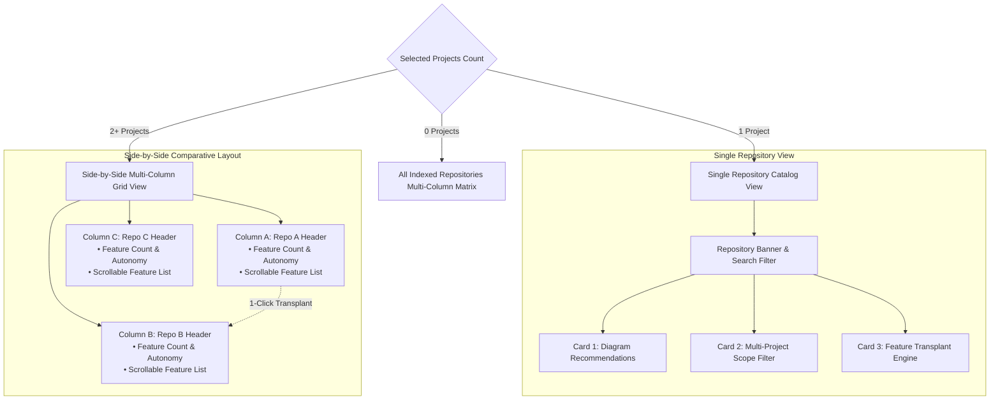

# RFC 022: Features & Capabilities Multi-Repository Comparison Page

- **RFC Number:** 022
- **Title:** Features & Capabilities Multi-Repository Comparison Page
- **Status:** Implemented
- **Author:** Codebase Memory Architecture Team
- **Target Subsystem:** `graph-ui/src/App.tsx`, `graph-ui/src/components/FeaturesTab.tsx`, `graph-ui/src/lib/types.ts`, `graph-ui/src/lib/i18n.ts`, `graph-ui/src/components/FeaturesTab.test.tsx`
- **Target Version:** v0.22.0
- **Created:** 2026-10-15
- **Related RFCs:** [RFC 016](RFC_016_Diagram_Recommendation_Engine.md) (Diagram Recommendations), [RFC 017](RFC_017_Standardized_Documentation_And_Artifact_Storage.md) (Standardized Documentation), [RFC 018](RFC_018_Agent_Context_And_Instruction_Architecture.md) (Agent Context Architecture), [RFC 019](RFC_019_Interactive_Multi_Project_Elicitation_And_Cross_Repo_Transplant.md) (Cross-Repo Feature Transplant), [RFC 020](RFC_020_Multi_Project_Selection_And_Application_Wide_Filter.md) (Multi-Project Selection & Filter), [RFC 021](RFC_021_Automated_Repository_Feature_Extraction_And_Capability_Catalog.md) (Automated Feature Extraction Engine)

---

## TL;DR — Impact at a Glance

| Question | Answer |
|---|---|
| **What does this RFC propose?** | 1. **New Top-Level Navigation Tab:** Introduce a dedicated **Features** tab in the main navigation bar, positioned strategically **between Diagrams and ADR** (`[Diagrams] [Features] [ADR]`).<br>2. **Single-Repository Feature Catalog View:** For a single selected repository, presents a rich, searchable inventory of functional capabilities with categories, surface entry points, autonomy scores, and covering test suites.<br>3. **Side-by-Side Multi-Repository Column Layout:** When multiple repositories are selected (`selectedProjects = ['repoA', 'repoB']`), renders a side-by-side multi-column comparison interface with one dedicated list per repository, headed by the repository name.<br>4. **Direct Action Workflows:** Feature cards feature 1-click actions: **"Transplant Feature"** (launching RFC 019 transplant manifests), **"Inspect Subgraph"** (deep-linking into GraphTab), and **"Generate Diagram"** (scoping RFC 016 diagrams). |
| **Why is this needed?** | While RFC 021 specified the extraction engine and scoring algorithm, developers and architects need an intuitive visual surface to browse capabilities, compare multi-repo systems (e.g., frontend vs. backend microservices), identify functional gaps, and initiate cross-repository feature transplantation without writing CLI commands. |
| **Does it touch Core C?** | **No (0% Core C modifications).** Under the **Core C Preference Rule**, all navigation routing, multi-column CSS grid layouts, feature card states, and API consumption live entirely within the React/TypeScript frontend (`graph-ui`). |
| **Is it backwards compatible?** | **Yes, 100% backwards compatible.** Extends the `TabId` union (`"features"`) and cleanly integrates with RFC 020's URL query param synchronization (`?tab=features&projects=repoA,repoB`). If a single project is selected, it renders a focused single-column view. |

---

## 1. Motivation & Problem Statement

### 1.1 The Need for a Visual Capability Surface
In modern software engineering, architectures are evaluated by their **capabilities**. Codebase Memory already provides:
- Low-level AST navigation: `[Graph]`
- Code health & analytical metrics: `[Reports]`
- Agent context & instruction audits: `[Readiness]`
- Visual architecture topologies: `[Diagrams]`
- Architectural decision history: `[ADR]`

However, there is no high-level page answering the fundamental question:
> *"What does this repository actually do, and how do its capabilities compare to our other services?"*

Developers must either execute CLI commands (`node scripts/extract-features.mjs`) or read individual RFC documents to discover what features exist. A dedicated **Features** page bridges this visual gap.

### 1.2 Multi-Service & Microservice Comparative Slicing
In distributed architectures, features rarely live in total isolation. A full-stack system often spans:
1. A frontend UI repository (`codebase-memory-mcp-ui`)
2. A backend C daemon repository (`codebase-memory-mcp`)
3. A shared analytical microservice (`CodeVisualizer` or `docling`)

Under [RFC 020](RFC_020_Multi_Project_Selection_And_Application_Wide_Filter.md), users can select multiple repositories simultaneously (`?projects=repoA,repoB`). When viewing features, users need to see **side-by-side columns**—one list per repository, headed by the repository's name—to immediately understand:
- Which service provides which capability.
- Where functional redundancy or duplication exists across squads.
- Which capabilities in Repo A can be transplanted into Repo B using [RFC 019](RFC_019_Interactive_Multi_Project_Elicitation_And_Cross_Repo_Transplant.md).

---

## 2. Core C Preference Rule Justification

The user-defined project rule stipulates:
> **Core C Preference Rule:** ALWAYS prefer implementations that do NOT touch or modify the Core C codebase... ONLY propose or implement changes in Core C when there is a serious, demonstrable performance difference or a strict technical constraint that cannot be achieved outside C.

### Architectural Compliance Analysis
1. **Presentation & State Concern:**
   The Features page is entirely an ergonomic visualization and multi-column comparison interface.
2. **Existing Backend Capabilities:**
   The backend daemon already provides the requisite project metadata (`list_projects`, `get_api_surface`, `get_architecture`, `audit_test_coverage`), and RFC 021 established the feature extraction synthesis outside C.
3. **Conclusion:** **0% Core C modifications required.** All implementation work is confined to `graph-ui/`.

---

## 3. Navigation Bar Placement

The main navigation bar in `graph-ui/src/App.tsx` will be updated to place **Features** directly between **Diagrams** and **ADR**:

```
┌────────────────────────────────────────────────────────────────────────────────────────────────────────┐
│  Codebase Memory v0.22.0    [Projects] [Tools] [Control] | [Graph] [Reports] [Readiness] [Diagrams]   │
│                                                            [Features] [ADR]    [ 2 Projects Selected ▾]│
└────────────────────────────────────────────────────────────────────────────────────────────────────────┘
```

### 3.1 Tab Identifier & Sequence
In `graph-ui/src/App.tsx` and `graph-ui/src/lib/types.ts`:
```typescript
export type TabId =
  | "stats"
  | "tools"
  | "control"
  | "graph"
  | "reports"
  | "readiness"
  | "diagrams"
  | "features"  // NEW: Positioned between diagrams and adr
  | "adr";
```

### 3.2 Navigation Tab Metadata
- **Tab ID:** `"features"`
- **Display Label:** `"Features"`
- **Icon:** `Sparkles` or `Boxes` from `lucide-react`
- **URL Parameter:** `?tab=features` (e.g. `http://localhost:5173/?tab=features&projects=repoA,repoB`)

---

## 4. UI & UX Architecture

### 4.1 Layout Overview



### 4.2 Multi-Repository Side-by-Side Comparison Layout
When multiple repositories are selected (`selectedProjects.length > 1`), the viewport renders a responsive, horizontally scrollable multi-column grid:

```
┌────────────────────────────────────────────────────────────────────────────────────────────────────────┐
│  Features & Capabilities Catalog                                                                       │
│  Comparing 2 Selected Repositories: codebase-memory-mcp-ui, docling             [ Global Search...  ]  │
├───────────────────────────────────────────────────┬────────────────────────────────────────────────────┤
│  ◈ codebase-memory-mcp-ui                         │  ◈ docling                                         │
│  7 Features Discovered • Avg Autonomy: 88/100     │  4 Features Discovered • Avg Autonomy: 89/100      │
│  [ Filter Repo A...         ]                     │  [ Filter Repo B...         ]                      │
├───────────────────────────────────────────────────┼────────────────────────────────────────────────────┤
│  ┌──────────────────────────────────────────────┐ │  ┌──────────────────────────────────────────────┐  │
│  │ Diagram Recommendation Engine & Studio       │ │  │ Document Layout OCR & Parsing Engine         │  │
│  │ Category: Analysis & Visualization           │ │  │ Category: Document Processing                │  │
│  │ Autonomy: [████████░░] 88/100 (Low Coupling) │ │  │ Autonomy: [█████████░] 92/100 (Low Coupling) │  │
│  │ • 3 Files (1,420 LOC) • 14 Tests Passing     │ │  │ • 6 Files (2,840 LOC) • 18 Tests Passing     │  │
│  │ • Triggers: `export_diagram`, `DiagramsTab`  │ │  │ • Triggers: `parse_document`, CLI `docling`  │  │
│  │                                              │ │  │                                              │  │
│  │ [ 🔍 Subgraph ] [ 📦 Transplant ] [ 📄 RFC ] │ │  │ [ 🔍 Subgraph ] [ 📦 Transplant ] [ 📄 Readme]│  │
│  └──────────────────────────────────────────────┘ │  └──────────────────────────────────────────────┘  │
│                                                   │                                                    │
│  ┌──────────────────────────────────────────────┐ │  ┌──────────────────────────────────────────────┐  │
│  │ Multi-Project Scope Filter                   │ │  │ Table Structure Recognition Engine           │  │
│  │ Category: UI & Scope Filtering               │ │  │ Category: ML Extraction                      │  │
│  │ Autonomy: [████████░░] 88/100 (Low Coupling) │ │  │ Autonomy: [████████░░] 84/100 (Low Coupling) │  │
│  │ • 2 Files (509 LOC) • 2 Tests Passing        │ │  │ • 4 Files (1,210 LOC) • 8 Tests Passing      │  │
│  │ • Triggers: Header Switcher, `?projects=`    │ │  │ • Triggers: `extract_tables`, API handler    │  │
│  │                                              │ │  │                                              │  │
│  │ [ 🔍 Subgraph ] [ 📦 Transplant ] [ 📄 RFC ] │ │  │ [ 🔍 Subgraph ] [ 📦 Transplant ] [ 📄 Readme]│  │
│  └──────────────────────────────────────────────┘ │  └──────────────────────────────────────────────┘  │
└───────────────────────────────────────────────────┴────────────────────────────────────────────────────┘
```

### 4.3 Feature Card Anatomy & Interactive Controls
Each feature card within a repository column contains:
1. **Header:** Feature Name, Category badge (e.g. `Analysis`, `Core Engine`, `UI`, `Security`).
2. **Summary:** Brief description of functional behavior.
3. **Autonomy Meter:** Visual progress bar depicting Autonomy Score (0–100) with color-coded coupling badge (`low` = green, `medium` = amber, `high` = rose).
4. **Metrics Strip:** File count, approximate LOC, and test verification badge (`✓ 14 Tests Passing` or `⚠ Unverified`).
5. **Surface Triggers:** Chips showing how the feature is triggered (`mcp_tool`, `http_route`, `ui_component`, `cli_script`).
6. **Intent Links:** Clickable markdown links to relevant RFCs or ADRs.
7. **Action Toolbar:**
   - **🔍 Subgraph:** Navigates to `GraphTab` and isolates the nodes/edges constituting this feature.
   - **📦 Transplant:** Initiates a cross-repo transplant (RFC 019) with source repository and feature pre-filled.
   - **📄 Docs:** Opens the feature's architectural specification modal.

---

## 5. Technical Specification

### 5.1 Component Hierarchy
```
graph-ui/src/
├── App.tsx                        // Navigation routing, tab switching, URL sync
├── components/
│   ├── FeaturesTab.tsx            // Main Features page container
│   ├── features/
│   │   ├── FeatureColumn.tsx      // Single repository column container
│   │   ├── FeatureCard.tsx        // Individual feature capability card
│   │   ├── AutonomyBadge.tsx      // 0-100 score meter with coupling pill
│   │   └── FeatureDetailModal.tsx // Deep inspection modal (AST slices, dependencies)
│   └── FeaturesTab.test.tsx       // Vitest unit and integration suite
└── lib/
    ├── types.ts                   // TabId union & Feature definition interfaces
    └── i18n.ts                    // Localization strings
```

### 5.2 TypeScript Interfaces (`graph-ui/src/lib/types.ts`)
```typescript
export interface FeatureTrigger {
  kind: "mcp_tool" | "mcp_prompt" | "http_route" | "ui_component" | "ui_tab" | "cli_script" | "c_api";
  name?: string;
  path?: string;
}

export interface FeatureVerification {
  hasTests: boolean;
  testSuites: string[];
  testCount: number;
}

export interface FeatureTransplantReadiness {
  autonomyScore: number;
  coupling: "low" | "medium" | "high";
  verdict: string;
}

export interface RepositoryFeature {
  id: string;
  name: string;
  category: string;
  summary: string;
  documentation: string[];
  surfaceTriggers: FeatureTrigger[];
  coreFiles: string[];
  dependencies: {
    externalLibraries: string[];
    sharedUtilities: string[];
  };
  verification: FeatureVerification;
  transplantReadiness: FeatureTransplantReadiness;
}

export interface RepositoryFeatureCatalog {
  project: string;
  timestamp: string;
  totalFeatures: number;
  granularity: "coarse" | "fine";
  features: RepositoryFeature[];
}
```

### 5.3 Responsive Multi-Column Layout Strategy
- Uses CSS Grid with dynamic columns based on selected projects count:
  - 1 project: `grid-cols-1 max-w-4xl mx-auto`
  - 2 projects: `grid-cols-1 md:grid-cols-2 gap-6`
  - 3+ projects: `grid-flow-col auto-cols-[380px] overflow-x-auto gap-6`
- Sticky repository headers remain visible at the top while scrolling individual feature columns.

---

## 6. Integration with Other Subsystems

| Subsystem | Integration Behavior |
|---|---|
| **Multi-Project Scope Filter ([RFC 020](RFC_020_Multi_Project_Selection_And_Application_Wide_Filter.md))** | Automatically synchronizes displayed repository columns with the application-wide `selectedProjects` state and URL query string (`?tab=features&projects=repoA,repoB`). |
| **Cross-Repo Transplant Engine ([RFC 019](RFC_019_Interactive_Multi_Project_Elicitation_And_Cross_Repo_Transplant.md))** | Clicking **"Transplant"** on any feature card pre-populates `scripts/transplant-feature.mjs` parameters with `source_project` and `feature`. |
| **Feature Extraction Engine ([RFC 021](RFC_021_Automated_Repository_Feature_Extraction_And_Capability_Catalog.md))** | Directly consumes the JSON catalogs produced by `scripts/extract-features.mjs` and native MCP data endpoints. |
| **Diagram Recommendation Engine ([RFC 016](RFC_016_Diagram_Recommendation_Engine.md))** | Allows generating feature-scoped Mermaid diagrams by passing `scope_path` from the feature's `coreFiles`. |

---

## 7. Test & Verification Plan

### 7.1 Vitest Unit Tests (`FeaturesTab.test.tsx`)
1. **Navigation & Tab Registration:**
   - Verify `"features"` is recognized as a valid `TabId`.
   - Verify clicking the Features tab navigates to `?tab=features`.
   - Verify the tab button appears between Diagrams and ADR in the DOM order.
2. **Single-Project Rendering:**
   - Renders repository banner and all feature cards for the selected project.
   - Verifies autonomy score progress bars, category pills, and trigger badges.
   - Filters cards by search query and category filters.
3. **Multi-Project Side-by-Side Layout:**
   - When 2 projects are provided (`projects=["repoA", "repoB"]`), renders 2 distinct repository columns.
   - Confirms each column displays its respective repository name at the top.
   - Verifies independent column scrolling and search filtering.
4. **Action Workflows:**
   - Clicking "Transplant" navigates or triggers the transplant modal with correct pre-filled attributes.
   - Clicking "Inspect Subgraph" navigates to the Graph view.

### 7.2 Visual E2E Validation
- Use `browser_subagent` on `http://localhost:5173/?tab=features&projects=codebase-memory-mcp-ui,docling` to verify:
  - Responsive multi-column layout.
  - Sticky header behavior.
  - Clean typography and dark-mode glassmorphic aesthetics.

---

## 8. Implementation Roadmap & Milestones

- **Milestone 1:** Update `TAB_IDS`, `TabId`, and navigation bar in `App.tsx` (placing Features between Diagrams and ADR).
- **Milestone 2:** Implement `FeaturesTab.tsx` with single-project catalog rendering and multi-project side-by-side columns.
- **Milestone 3:** Wire action handlers (Transplant Feature, Inspect Subgraph, View Specification).
- **Milestone 4:** Author Vitest unit tests in `FeaturesTab.test.tsx` and verify clean execution across the entire test suite.

---

## 9. Summary & Sign-off

RFC 022 gives Codebase Memory a first-class visual **Capabilities & Features Page**. Placed seamlessly between Diagrams and ADR, it turns abstract codebase graphs into tangible, side-by-side functional inventories—enabling engineers to compare repositories, spot redundancies, and port capabilities with unprecedented visual clarity.
